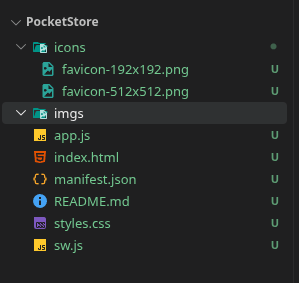
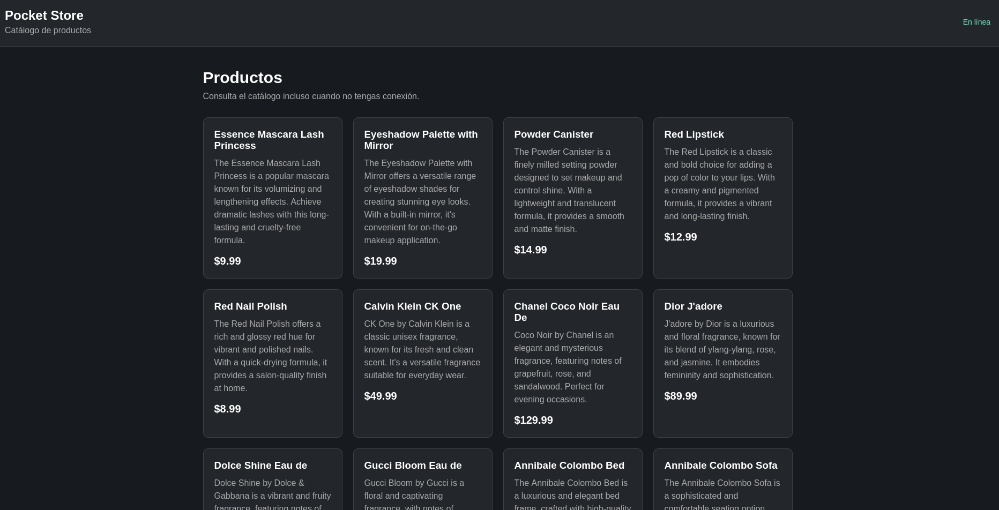
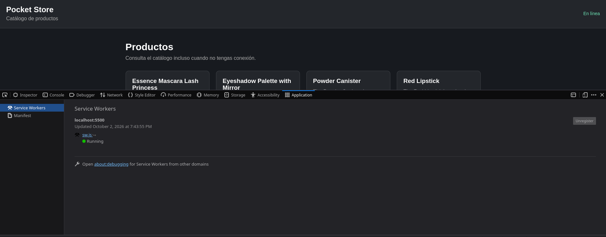
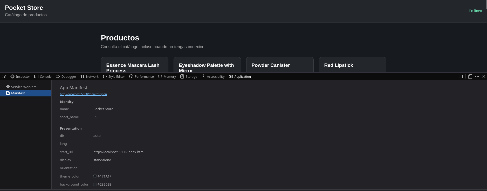
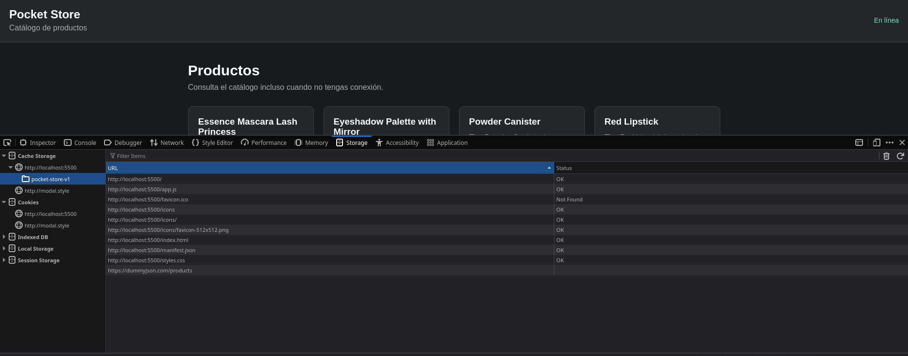
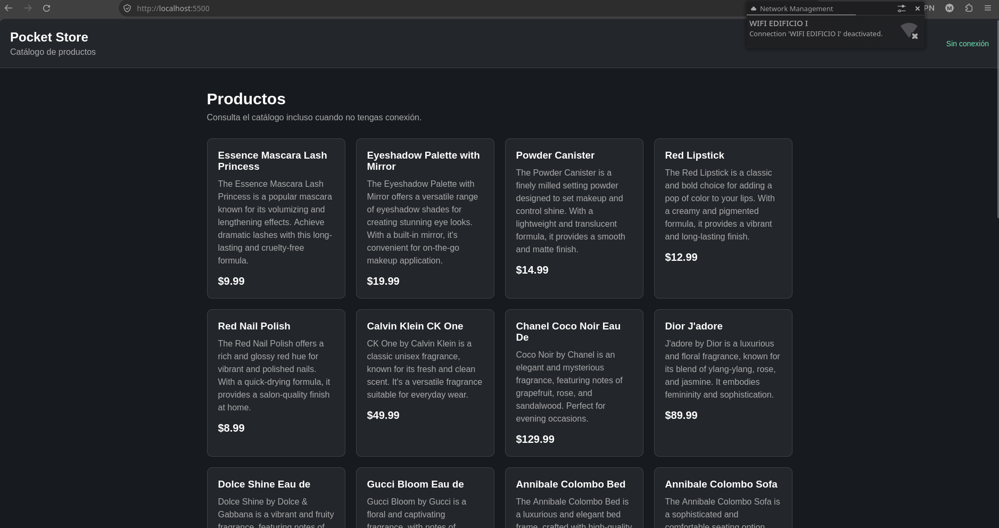

# Pocket Store

PWA de una sola página que muestra productos y funciona sin conexión.

## Archivos

```text
pocket-store/
├── index.html
├── styles.css
├── app.js
├── sw.js
├── manifest.json
└── README.md
```

## API

Se utiliza:

```text
https://dummyjson.com/products
```

## Funcionamiento

* `index.html`: estructura.
* `styles.css`: estilos.
* `app.js`: obtiene y muestra los productos.
* `sw.js`: Service Worker y caché.
* `manifest.json`: configuración de la PWA.

## Prueba

La aplicación se probó con conexión y posteriormente sin conexión para comprobar el funcionamiento del Service Worker y la caché.

## Evidencias

### 1. Estructura del proyecto

Aquí se muestra la estructura de archivos.

**Evidencia:**



### 2. Aplicación funcionando

Aquí se muestra la aplicación cargando los productos desde la API.

**Evidencia:**


### 3. Service Worker

Aquí se muestra el Service Worker registrado y activo.

**Evidencia:**



### 4. Manifest

Aquí se muestra el Manifest.

**Evidencia:**



### 5. Caché

Aquí se muestra la caché generada por el Service Worker.

**Evidencia:**



### 6. Funcionamiento sin conexión

Aquí se muestra la aplicación funcionando sin conexión a Internet.

**Evidencia:**
